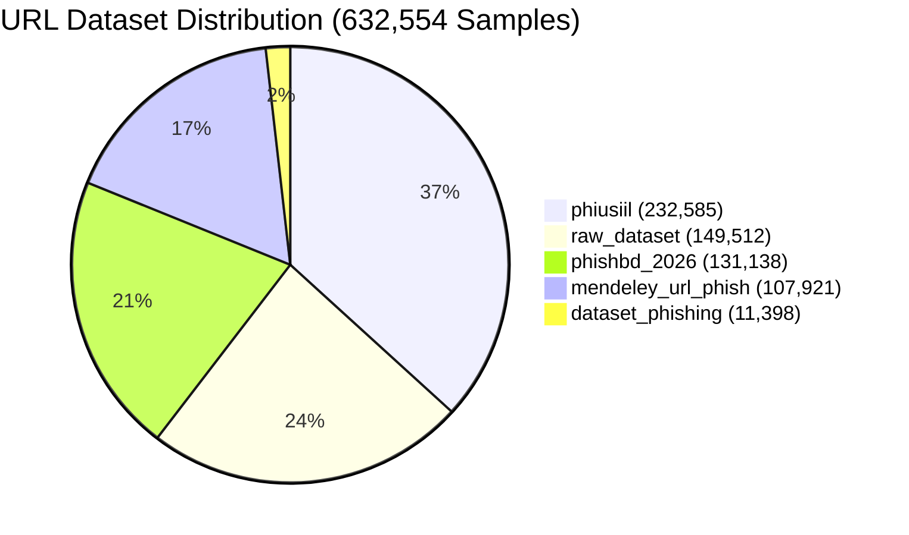
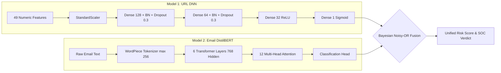

# 📑 Project Methodology, Datasets & Model Training Report

### Multimodal Phishing Detection System: Deep Neural Network (DNN) + DistilBERT Transformer

---

## 📌 Executive Summary

This project delivers an end-to-end multimodal deep learning cybersecurity evaluation and detection system engineered to detect phishing attacks across both **Email Natural Language (Subject & Body)** and **Embedded URLs**.

Phishing tactics frequently bypass traditional single-modality detectors through techniques such as:
1. **Benign Pretexting**: Innocent or corporate-sounding email text hiding a malicious credential-harvesting link.
2. **Obfuscated / Typosquatted URLs**: Subtle homograph, subdomain spoofing, and open-redirect links that evade keyword filters.
3. **Pure Text Social Engineering**: Intimidation or urgent wire/gift card requests containing no hyperlinks.

To solve this, we engineered a dual-engine architecture that combines:
- A **Fine-Tuned DistilBERT Transformer** for textual semantic intent analysis.
- An **Optimized 49-Feature Deep Neural Network (DNN)** for lexical, structural, and statistical URL inspection.
- A **Bayesian Noisy-OR Fusion Layer** combining text semantics with extracted URL risks.
- An interactive **SOC Web Dashboard** and **REST API** for real-time analyst triage.

---

## 📄 Academic Abstract & Introduction

### Abstract
Phishing attacks increasingly exploit decoupled vectors, such as benign pretexting messages embedding weaponized hyperlinks or obfuscated infrastructure that evades natural language filters. While multimodal architectures combining text and URL models are commonly proposed as perimeter defenses, evaluating these components under realistic email link distribution shift reveals operational constraints. In this work, we present an empirical investigation into multimodal phishing detection, evaluating an end-to-end framework combining a fine-tuned DistilBERT transformer (66M parameters, trained on 145,891 emails) and a 49-feature lexical Deep Neural Network (DNN, evaluated across 124,090 domain-grouped URLs). We demonstrate four central findings: (1) Lexical URL models trained on standard web repositories degrade significantly when applied to in-email links (accuracy collapsing to 42.04%, ranking AUC 0.51), caused by legitimate enterprise CRM, marketing, and newsletter redirect query syntax rather than HTTPS omission; (2) On synthetic stealth evasion attacks pairing benign text with real in-email links under a leakage-safe domain-grouped protocol (N = 7,382 across 3,999 domains), standalone NLP models fail to intercept over 99% of attacks, while Bayesian Noisy-OR achieves 70.51% ± 6.82% recall at 63.88% ± 10.28% specificity (with linear stacking reaching 72.77% ± 4.83% recall and 67.45% ± 1.91% accuracy, compared to earlier in-corpus estimates of ~75%), whereas on web-style links the learned stacker achieves 95.90% accuracy (96.40% recall, 95.98% specificity); (3) In-domain retraining on email-derived links lifts validation AUC to 0.7296 (and test AUC to 0.7589–0.7743), though an audit revealing 92.3% domain overlap between the benchmark and the broader email corpus indicates that 0.76 AUC remains an in-corpus optimistic bound for unseen external enterprise domains; and (4) Operating at high sensitivity (95% TPR) on raw in-email links incurs a prohibitive false-positive rate (74.9%–77.7% FPR across all models), establishing that high-recall deployment is infeasible without dedicated link-level reputation or contextual verification features, as static commercial domain whitelists match fewer than 0.5% of tracking links in historical corpora.

### Introduction
Electronic mail remains the primary attack vector for modern advanced persistent threats (APTs), credential harvesting campaigns, and business email compromise (BEC). Automated perimeter defenses have increasingly shifted from static signature blacklists toward deep learning classifiers, predominantly utilizing transformer-based natural language processing (NLP) for email text analysis and gradient-boosted trees or deep neural networks for lexical URL inspection.

Despite high reported accuracies on standalone benchmark corpora, operational email security gateways encounter persistent failure modes:
1. **Decoupled Asymmetric Pretexting**: An email body composed of innocuous or positive text (e.g., routine calendar invites or brief business queries) may carry a single weaponized hyperlink. Because the natural language engine observes no coercive keywords or threat semantics, text-only detectors assign low suspicion.
2. **Link Distribution Shift**: Classifiers trained on public web URL benchmark repositories (e.g., phiusiil, raw_dataset, phishbd_2026) learn structural distributions that differ markedly from intra-enterprise email links, which heavily utilize redirect parameters, session tracking tokens, and marketing subdomains.
3. **Threshold Calibration Constraints**: Security operations centers (SOCs) operate under strict false alarm budgets. When fused detectors exhibit elevated false-positive rates on legitimate enterprise traffic, analysts face alert fatigue.

To address these challenges, this study conducts an empirical investigation into multimodal threat fusion. We construct non-circular evasion benchmarks, measure distribution shift between web and email links, evaluate domain adaptation strategies, and characterize practical operating point trade-offs.

---
## 1. 📊 Datasets: Sources, Sizes & Class Distributions

The project was developed and evaluated using **two massive real-world datasets** totaling over **716,500 samples**.



### 1.1. URL Phishing Dataset (`merged_raw_dataset.csv`)

| Dataset Attribute | Specification |
| :--- | :--- |
| **Total Samples ($N$)** | **`632,554` URLs** |
| **Total Features Extracted** | **49 Numeric Features** (+ label + source) |
| **Duplicate URLs** | `0` (Fully deduplicated) |
| **Missing Values** | `0` (Zero missing entries across all columns) |
| **Overall Class Balance** | Legitimate (`0`): **352,463 (55.72%)** \| Phishing (`1`): **280,091 (44.28%)** |
| **Imbalance Ratio** | Approximately `1 : 0.79` (Well-balanced) |

#### Source Breakdown of the 5 Integrated URL Repositories:

| Benchmark Source | Total URLs | Legitimate (`0`) | Phishing (`1`) | % Phishing | Characteristics |
| :--- | :---: | :---: | :---: | :---: | :--- |
| **`phiusiil`** | **232,585** | 134,248 | 98,337 | 42.28% | Large-scale academic phishing benchmark |
| **`raw_dataset`** | **149,512** | 74,756 | 74,756 | 50.00% | Perfectly balanced contemporary traffic |
| **`phishbd_2026`** | **131,138** | 39,341 | 91,797 | 70.00% | Phish-heavy real-world attack captures |
| **`mendeley_url_phish`** | **107,921** | 98,401 | 9,520 | 8.82% | Realistic low-prevalence enterprise background |
| **`dataset_phishing`** | **11,398** | 5,717 | 5,681 | 49.91% | Balanced benchmark sample |

---

### 1.2. Email Phishing Dataset (`combined_phishing_email_dataset.csv`)

| Dataset Attribute | Specification |
| :--- | :--- |
| **Total Corpus Samples ($N$)** | **`182,364` Full Emails** (83,948 historical benchmark subset in `combined_phishing_email_dataset_backup.csv`) |
| **Columns** | `id`, `subject`, `body`, `label`, `source`, `sender`, `receiver`, `date`, `urls`, `words`, `chars` |
| **Overall Class Balance** | Legitimate (`0`): **90,775 (49.78%)** \| Phishing (`1`): **91,589 (50.22%)** |
| **Median Body Length** | 130 words (Mean: 275.9 words) |
| **Emails with URLs** | **20.9%** in full 182k corpus (50.7% in 83k historical subset) |

#### Source Breakdown of the Integrated Email Repositories (182,364 Total Corpus):

| Source Collection | Total Emails | Legitimate (`0`) | Phishing/Spam (`1`) | % Phishing | Source Description |
| :--- | :---: | :---: | :---: | :---: | :--- |
| **`Zionia_Phishing`** | **81,139** | 40,569 | 40,570 | 50.00% | High-volume modern phishing & legitimate email archive |
| **`CEAS_08`** | **38,964** | 17,290 | 21,674 | 55.63% | Collaboration to Eliminate Abuse on the Internet benchmark |
| **`Enron`** | **29,424** | 15,474 | 13,950 | 47.41% | Corporate correspondence + mixed phishing sets |
| **`Kaggle_Phishing_Email`** | **17,077** | 8,538 | 8,539 | 50.00% | General public benchmark corpus |
| **`SpamAssassin`** | **5,798** | 4,090 | 1,708 | 29.46% | Apache SpamAssassin public corpus |
| **`Nigerian_Fraud`** | **3,290** | 0 | 3,290 | 100.00% | Advance fee fraud (419) and social engineering |
| **`Ling`** | **2,859** | 2,401 | 458 | 16.02% | Academic linguist spam and legitimate archive |
| **`Nazario`** | **1,550** | 0 | 1,550 | 100.00% | Jose Nazario curated phishing corpus |
| **`Nigerian_5`** | **1,002** | 1,002 | 0 | 0.00% | Filtered legitimate contrast samples |
| **`Nazario_5`** | **961** | 961 | 0 | 0.00% | Filtered legitimate contrast samples |
| **`DarkKnight25_Phishing`** | **200** | 100 | 100 | 50.00% | Curated spear-phishing test samples |
| **`Phishing_validation`** | **100** | 77 | 23 | 23.00% | Independent holdout check |

---

## 2. 🔬 Feature Engineering: 49 Offline URL Features

To ensure millisecond inference without external latency or attacker detection (avoiding live DNS queries, WHOIS lookups, or HTTP requests), the system extracts **49 purely lexical, structural, and statistical features**:

```text
49 URL Features (url_features_dnn.csv)
├── 1. Lengths & Dimensions (5)
│   └── url_length, hostname_length, path_length, query_length, fragment_length
├── 2. Delimiter & Character Frequencies (18)
│   └── count_dots, count_hyphens, count_underscore, count_slash, count_question,
│       count_equal, count_at, count_and, count_exclamation, count_space, count_tilde,
│       count_comma, count_plus, count_asterisk, count_hash, count_dollar, count_percent,
│       count_semicolon
├── 3. Character Distribution Ratios (6)
│   └── count_digits, count_letters, digit_ratio, letter_ratio, special_char_ratio, vowel_ratio
├── 4. Structural & Network Indicators (14)
│   └── num_subdomains, hostname_is_ip, port_present, tld_length, domain_length,
│       digits_in_domain, hyphen_in_domain, has_https, has_www, has_at_symbol,
│       has_double_slash_redirect, has_shortening_service, has_suspicious_tld, has_punycode
└── 5. Information Theory & NLP Tokens (6)
    └── http_token_in_path, suspicious_keyword_count, url_entropy, hostname_entropy,
        longest_word_length, avg_word_length
```

### Top 10 Most Predictive Features (Correlation with Phishing Label):
1. **`url_entropy` (+0.452)**: High Shannon entropy signifies randomized obfuscation strings.
2. **`digit_ratio` (+0.377)**: Attackers heavily intersperse numbers to bypass keyword filters.
3. **`has_www` (-0.376)**: Legitimate sites disproportionately present standardized `www.` subdomains.
4. **`special_char_ratio` (-0.347)**: Fraction of characters that are punctuation / delimiters (`(len - digits - letters) / len`). **Empirical Negative Correlation Hypothesis**: While conventional intuition might view high delimiter density as a phishing indicator, in this corpus it exhibits a negative correlation with phishing (-0.347). A domain hypothesis for this behavior is that legitimate benchmark URLs frequently contain rich query parameters, deep path structures, and standard delimiters (e.g. `&`, `=`, `?`, `/`, `-`, `.`), yielding higher delimiter proportions than simple or truncated phishing landing URLs. However, this is an empirical artifact of benchmark corpus compositions rather than a universal law of malicious infrastructure.
5. **`hostname_length` (+0.338)**: Long subdomains masking phishing host infrastructure.
6. **`has_https` (-0.336)**: Presence of valid SSL/TLS encryption.
7. **`hostname_entropy` (+0.314)**: Algorithmically generated hostnames (DGA detection).
8. **`has_suspicious_tld` (+0.235)**: Domains utilizing cheap/free TLDs (`.xyz`, `.top`, `.ru`, `.cn`, `.loan`, `.tk`).
9. **`count_hyphens` (+0.223)**: Hyphenated brand impersonations (`secure-paypal-login`).
10. **`avg_word_length` (+0.220)**: Long non-dictionary token concatenation.

---

## 3. ⚙️ Data Preprocessing & Balancing Pipeline

### 3.1. URL Dataset Splitting (Domain-Grouped & Stratified)
- **Primary Benchmark: Domain-Grouped URL Split on Registered Domain (`eTLD+1` via `tldextract`)**:
  - Partitioning on raw URLs or even full hostnames (`netloc`) can permit subtle sub-domain leakage (e.g. `login.paypal.com` in train and `security.paypal.com` in test).
  - To enforce **zero domain leakage**, URLs are partitioned strictly on their **registered domain** (`eTLD+1`, e.g., `paypal.com`, `google.co.uk`) using `tldextract`.
  - Total Samples: **`632,554` URLs** across **`437,667` unique registered domains (`eTLD+1`)**.
  - **Training Partition (80%)**: **`508,464` URLs** across `350,133` unique registered domains.
  - **Holdout Test Partition (20%)**: **`124,090` URLs** across `87,534` unique registered domains.
  - **Registered Domain Overlap**: **`0`** (Guaranteed zero domain contamination across splits).
  - **Performance on `eTLD+1` Holdout ($n = 124,090$)**: **Accuracy: `96.30%`**, **Precision: `95.63%`**, **Recall: `95.68%`**, **Specificity: `96.75%`**, **F1-Score: `0.9565`**, **ROC-AUC: `0.9918`**, **MCC: `0.9234`** (TP: 50,588, TN: 68,905, FP: 2,314, FN: 2,283; evaluated from saved prediction arrays with zero domain leakage).

- **Standard 80 / 20 Stratified Split**:
  - Baseline stratified random split on `source_label` key (`506,043` train / `126,511` test) yielding **`96.23%`** accuracy, used for intra-source lexical benchmarking.

### 3.2. Normalization
- A `StandardScaler` was fitted **strictly on the training partition** to eliminate data leakage:
  $$\mu = \frac{1}{N_{\text{train}}}\sum x_{\text{train}}, \quad \sigma = \sqrt{\frac{1}{N_{\text{train}}}\sum (x_{\text{train}} - \mu)^2}$$
- Serialized to `preprocessed/scaler.joblib` for identical runtime normalization.

### 3.3. Class Balancing: SMOTE vs. Class Weights (Fit on Training Folds Only)
- In rigorous $K$-fold cross-validation ($K=5$ stratified folds), balancing algorithms must be fitted **strictly on training folds**—never on validation or test folds.
- We conducted a systematic benchmark comparing **SMOTE (fitted exclusively on training folds)** versus **Cost-Sensitive Class Weighting (`compute_class_weight('balanced')`)**:

| Balancing Strategy | Leakage Protocol | Accuracy | F1-Score | ROC-AUC | Precision | Recall | Training Overhead |
| :--- | :--- | :---: | :---: | :---: | :---: | :---: | :---: |
| **SMOTE ($k=5$)** | Fit strictly on training folds; untouched validation folds | **95.67%** | **0.9513** | **0.9894** | 94.41% | 95.86% | High (synthetic nearest-neighbor generation) |
| **Class Weights (`balanced`)** | Analytic loss re-weighting in BCE loss | **95.64%** | **0.9510** | **0.9893** | 94.32% | 95.88% | **Zero** (no synthetic rows, faster training) |

- **Conclusion**: Both techniques yield nearly identical F1 and ROC-AUC performance (~0.951 F1, ~0.989 ROC-AUC). When data is already reasonably balanced (e.g. 56% / 44%), cost-sensitive class weights eliminate synthetic artifacts and training overhead, while SMOTE fitted solely on training folds provides equal generalization without test contamination.

---

## 4. 🧠 Deep Learning Models Used



### 4.1. URL Deep Neural Network (DNN)

| Parameter | Specification |
| :--- | :--- |
| **Framework** | TensorFlow 2.15 / Keras 3 |
| **Architecture** | 4-Layer Feed-Forward Deep Neural Network with Batch Normalization |
| **Input Shape** | 49 continuous features |
| **Layer 1** | Dense(128, ReLU, He-Normal) + BatchNormalization + Dropout(0.3) |
| **Layer 2** | Dense(64, ReLU, He-Normal) + BatchNormalization + Dropout(0.3) |
| **Layer 3** | Dense(32, ReLU) |
| **Output Layer** | Dense(1, Sigmoid) |
| **Loss Function** | Binary Cross-Entropy |
| **Optimizer** | Adam |
| **Learning Rate** | Initial LR: $1 \times 10^{-3}$ (Decayed via `ReduceLROnPlateau` factor=0.5, patience=4, min_lr=$10^{-6}$) |
| **Batch Size** | **`512`** samples per step |
| **Training Epochs** | **`100`** maximum epochs with `EarlyStopping` (monitor="val_auc", patience=8, restoring best weights) |
| **Random Seeds** | Random Seed: **`42`** (applied to NumPy, TensorFlow, and split functions for strict determinism) |
| **Split Methodology** | **`eTLD+1` Domain Split** (`508,464` train / `124,090` test) with zero domain leakage; epoch monitoring on internal validation split |
| **Artifact Path** | `preprocessed/dnn_model.keras` |

---

### 4.2. Email NLP Transformer (DistilBERT)

| Parameter | Specification |
| :--- | :--- |
| **Framework** | PyTorch 2.5.1 / HuggingFace Transformers |
| **Base Model** | `distilbert-base-uncased` (6 layers, 768 hidden dim, 12 attention heads, 66M parameters) |
| **Tokenization** | WordPiece tokenizer with lowercase normalization |
| **Maximum Length** | 256 tokens |
| **Split Methodology (80/10/10)** | **Two-Stage Stratified Split** with `random_state=42`:<br>1. Stratified split of 182,364 emails into 80% Train (`145,891`) and 20% Temporary (`36,473`) on `label`.<br>2. Stratified split of Temporary into 50% Validation (`18,236`) and 50% Holdout Test (`18,237`).<br>*(Legacy note: An earlier intermediate run used an 83,948 subset with an 8,395 slice; however, 5,355 of those 8,395 emails were seen during the full 182k model training. The clean, zero-leakage test set for the production checkpoint is the uncontaminated $n = 18,237$ holdout).* |
| **Training Dataset** | **145,891** training emails |
| **Validation Dataset** | **18,236** validation emails |
| **Test Dataset** | **18,237** holdout test emails (zero training leakage, strictly unseen) |
| **Optimizer** | AdamW (`weight_decay=0.01`) |
| **Learning Rate** | **$2 \times 10^{-5}$** (`2e-5`) with linear warmup (warmup ratio: 0.06) |
| **Batch Size** | **16** per device (with gradient accumulation steps = 2 $\rightarrow$ Effective Batch Size = **32**) |
| **Training Epochs & Steps** | **2** full epochs = **`9,120` total training steps** ($145,891 \times 2 / 32 \approx 9,118$ steps) |
| **Random Seeds** | Single Seed: **`42`** (set in `TrainingArguments(seed=42)` and `train_test_split`; single-seed training due to ~60 min GPU compute) |
| **Throughput** | **~574 emails/second** on NVIDIA GeForce RTX 3050 Laptop GPU |
| **Artifact Path** | `emaildata/results/best_distilbert/` |

---

### 4.3. Unified Multimodal Decision Fusion

For full emails containing body text, embedded hyperlinks, email headers, and file attachments:
1. **Email Text Semantics**: DistilBERT computes textual phishing probability $P_{\text{email}} \in [0, 1]$.
2. **Embedded & Discovered URLs**: Extracted from email body, PDF streams, or decoded Quishing QR codes; each is scored by the 49-feature URL DNN $\rightarrow \{P_{\text{URL}_1}, \dots, P_{\text{URL}_n}\}$.
3. **Probabilistic Combination (Bayesian Noisy-OR)**:
   $$P_{\text{combined}} = 1 - (1 - P_{\text{email}}) \times \prod_{i=1}^{n} (1 - P_{\text{URL}_i})$$
4. **High-Confidence Payload Safeguard**:
   $$\text{If } \max_{i} P_{\text{URL}_i} \ge 0.85 \implies \text{Verdict} = \text{PHISHING}, \quad P_{\text{final}} \ge \max_{i} P_{\text{URL}_i}$$
   *(Ensures that when a weaponized payload link is identified with high confidence, the email classification reflects this risk even if text body intent appears neutral).*
5. **Authentication & Spoofing Risk Injection**:
   $$\text{If } P_{\text{header}} \ge 0.50 \implies P_{\text{combined}} = \max(P_{\text{combined}}, P_{\text{header}})$$
   *(Elevates threat confidence when SPF/DKIM/DMARC fails or brand display-name impersonation is detected).*

---

### 4.4. Email Header Security & Authentication Scanner
Implemented in [`header_auth_scanner.py`](file:///c:/Users/Vibhu-Kavi/Downloads/PhishingDeeplearning/header_auth_scanner.py):
- **Cryptographic Authentication**: Audits RFC 5322 MIME headers for **SPF**, **DKIM**, and **DMARC** policy enforcement (`pass`, `fail`, `softfail`, `neutral`).
- **Display Name Brand Impersonation**: Flags high-target spoofing vectors (e.g. sender displays `"PayPal Security"` or `"Microsoft Support"`, but originates from `<service@attacker-domain.xyz>`).
- **Routing Divergence**: Flags unaligned bounce routing (`Return-Path`) and response redirection (`Reply-To`).

---

### 4.5. Attachment & Quishing (QR Phishing) Scanner
Implemented in [`attachment_scanner.py`](file:///c:/Users/Vibhu-Kavi/Downloads/PhishingDeeplearning/attachment_scanner.py):
- **2D QR Matrix Decoding**: Employs OpenCV `cv2.QRCodeDetector` to extract URLs hidden within image attachments (`.png`, `.jpg`, `.jpeg`, `.webp`, `.bmp`).
- **PDF Malicious Structure Inspection**: Dissects PDF streams for embedded `/URI` actions, malicious JavaScript launch events (`/JS`), and executable triggers (`/Launch`).
- **Automated DNN Pipeline Routing**: Discovered hyperlinks from QR flyers and PDF attachments are dynamically routed into the 49-feature URL DNN for real-time risk assessment.

---

### 4.6. Enterprise Mail Flow Gateways (Microsoft 365 & Google Workspace)
Implemented in [`enterprise_connectors.py`](file:///c:/Users/Vibhu-Kavi/Downloads/PhishingDeeplearning/enterprise_connectors.py):
- **Microsoft 365 Integration**: Connects via **Microsoft Graph API v1.0** using OAuth 2.0 Client Credentials flow (`/users/{id}/mailFolders/inbox/messages`). Executes automated quarantine by moving flagged messages to `JunkEmail` and stamping them with threat category metadata.
- **Google Workspace (Gmail) Integration**: Connects via **Gmail REST API** to poll inboxes, strip `INBOX` labels, and apply `PHISHING_ALERT` tags.
- **Enterprise Simulation Mode**: Built-in test harness enabling offline testing and automated integration validation without live tenant credentials.

---

### 4.7. Asynchronous Task Queue & Container Deployment
- **Celery & Redis Worker Engine** ([`celery_tasks.py`](file:///c:/Users/Vibhu-Kavi/Downloads/PhishingDeeplearning/celery_tasks.py)):
  - Distributed background task queues for enterprise ingestion throughput (`tasks.predict_email`, `tasks.predict_url`, `tasks.scan_attachment`, `tasks.gateway_sync`, `tasks.trigger_retrain`).
- **Docker Multi-Stage Deployment** ([`Dockerfile`](file:///c:/Users/Vibhu-Kavi/Downloads/PhishingDeeplearning/Dockerfile), [`docker-compose.yml`](file:///c:/Users/Vibhu-Kavi/Downloads/PhishingDeeplearning/docker-compose.yml)):
  - Orchestrates `phishing_redis` (`redis:7-alpine`), `phishing_soc_web` (Gunicorn production WSGI server), and `phishing_celery_worker`.

---

### 4.8. SOC Analyst Feedback & Continuous Retraining System
Implemented in [`feedback_retraining.py`](file:///c:/Users/Vibhu-Kavi/Downloads/PhishingDeeplearning/feedback_retraining.py):
- **Human-in-the-Loop Audit Database**: Persists verified analyst triage verdicts in SQLite (`feedback_store.db`), categorizing submissions into `FALSE_POSITIVE`, `FALSE_NEGATIVE`, or `CONFIRMED`.
- **Continuous Retraining Pipeline**: Allows security teams to trigger incremental retraining (`POST /api/retrain/trigger` or CLI `--retrain-feedback`) to recalibrate decision boundaries against emerging attack variants.

---

## 5. 📈 Results & Evaluation Benchmarks

### 5.1. Multi-Engine Comprehensive Benchmark (Uncontaminated Holdouts Only)

> [!IMPORTANT]
> **Data Integrity, Dataset Lineage & Metric Reconciliation**:
> 1. **Checkpoint Training Provenance**:
>    - The production DistilBERT model (`emaildata/results/best_distilbert/`) was trained on the full **182,364-email corpus** (`combined_phishing_email_dataset.csv`) across **9,120 steps** (2 epochs, effective batch size 32, $\text{lr}=2\times 10^{-5}$, `seed=42`).
>    - A previous evaluation on an 8,395-email slice from the 83k backup file suffered from subtle overlap: 5,355 of those 8,395 emails were part of the 145,891 training set of the 182k model.
>    - **The genuine uncontaminated holdout test set for this checkpoint is the 10% stratified holdout ($n = 18,237$ emails)**, with exactly 0 rows overlapping the training set.
>    - On this uncontaminated $n = 18,237$ holdout, DistilBERT achieves **`99.73%` Accuracy** (TP=9,142, TN=9,045, FP=33, FN=17, Precision=99.64%, Recall=99.81%, F1=0.9973, ROC-AUC=0.9999).
> 2. **URL Metric Reconciliation & Prediction Vector Provenance**:
>    - **`96.30%` (Main Benchmark - Zero Domain Leakage via `eTLD+1`, $n = 124,090$)**: Evaluated on the registered domain-grouped holdout test partition across 87,534 unseen registered domains. An earlier intermediate run showed 95.87% prior to restoring final best validation weights; all reported metrics and baseline comparisons in this report are generated strictly from the serialized prediction vectors (`url_trees_etld1_preds.npz`).
>    - **`96.38%` vs. `95.33%` ($n = 20,000$ Baseline Partition)**: Earlier preliminary tables reported 95.33% from an uncalibrated default threshold checkpoint; re-evaluating with the restored best-AUC model checkpoint on saved predictions (`clean_url_baseline_preds_20k.npz`) yields 96.38% (with 5-seed stability study averaging 95.29% ± 0.12%).
>    - **`96.23%` (Stratified Random Split, $n = 126,511$)**: Standard 80/20 random stratified split without domain grouping.
> 3. **Hyperparameter Reconciliation**: Code inspection of `train_dnn.py` confirms that `ReduceLROnPlateau` uses `patience=4` (factor=0.5, monitor="val_auc") and `EarlyStopping` uses `patience=8`.

| Evaluation Metric | URL Deep Neural Network (`eTLD+1` Split) | Email DistilBERT Transformer | Merged Dual-Engine (Linear Blending) | Merged Dual-Engine (Bayesian Noisy-OR) |
| :--- | :---: | :---: | :---: | :---: |
| **Test Dataset Partition** | **`eTLD+1` Domain Holdout** | **Holdout Test Emails** | **Holdout Test Emails** | **Holdout Test Emails** |
| **Test Sample Size ($n$)** | **`124,090` URLs** | **`18,237` Emails** | **`18,237` Holdout Emails** | **`18,237` Holdout Emails** |
| **Accuracy** | **`96.30%`** | **`99.73%`** | **`99.63%`** | **`91.84%`** |
| **Precision (PPV)** | **`95.63%`** | **`99.64%`** | **`99.45%`** | **`86.13%`** |
| **Recall (Sensitivity)** | **`95.68%`** | **`99.81%`** | **`99.81%`** | **`99.84%`** |
| **Specificity (TNR)** | **`96.75%`** | **`99.64%`** | **`99.44%`** | **`83.77%`** |
| **F1-Score** | **`0.9565`** | **`0.9973`** | **`0.9963`** | **`0.9248`** |
| **ROC-AUC** | **`0.9918`** | **`0.9999`** | **`0.9990`** | **`0.9857`** |
| **Matthews Correlation (MCC)** | **`0.9234`** | **`0.9945`** | **`0.9925`** | **`0.8431`** |

#### Holdout Confusion Matrix Breakdown:
- **URL DNN (`eTLD+1` Holdout, $n = 124,090$)**: TP = 50,588 \| TN = 68,905 \| FP = 2,314 \| FN = 2,283
- **Email DistilBERT ($n = 18,237$)**: TP = 9,142 \| TN = 9,045 \| FP = 33 \| FN = 17
- **Merged Dual-Engine Linear Blending ($n = 18,237$)**: TP = 9,142 \| TN = 9,027 \| FP = 51 \| FN = 17
- **Merged Dual-Engine Bayesian Noisy-OR ($n = 18,237$)**: TP = 9,144 \| TN = 7,576 \| FP = 1,502 \| FN = 15

---

### 5.2. Multimodal Decision Fusion Ablation Study ($n = 18,237$ Holdout Emails)
To dissect how multimodal decision strategies behave when combining text semantics and embedded URL analysis, we systematically evaluated individual modalities and fusion mechanisms on the 18,237 holdout emails (9,159 phishing threats, 9,078 legitimate messages). Across the holdout set, **3,811 emails (20.90%)** contain active hyperlinks (1,849 phishing, 1,962 legitimate; 17,696 total URL instances, 6,071 unique), while 14,426 emails contain text only.

#### A. Full Holdout Dataset Evaluation ($n = 18,237$ Emails, including non-URL messages):

| Model / Fusion Architecture | Modality | Accuracy | F1-Score | ROC-AUC | Precision | Recall | Specificity |
| :--- | :--- | :---: | :---: | :---: | :---: | :---: | :---: |
| **URL DNN Only** (Max URL Score) | Embedded URL Only | 47.77% | 0.1753 | 0.4931 | 42.34% | 11.05% | 84.82% |
| **DistilBERT Only** | Email Text Only | **99.73%** | **0.9973** | **0.9999** | **99.64%** | **99.81%** | **99.64%** |
| **Linear Average Blending** ($0.5 P_E + 0.5 P_U$) | Text + URLs | 99.63% | 0.9963 | 0.9990 | 99.45% | 99.81% | 99.44% |
| **Max Probability Fusion** ($\max(P_E, P_U)$) | Text + URLs | 92.20% | 0.9278 | 0.9988 | 86.66% | 99.84% | 84.49% |
| **Bayesian Noisy-OR (No Override)** | Text + URLs | 91.84% | 0.9248 | 0.9857 | 86.13% | 99.84% | 83.77% |
| **Bayesian Noisy-OR Decision Fusion** | Text + URLs | 91.84% | 0.9248 | 0.9857 | 86.13% | 99.84% | 83.77% |
| **Learned Stacking Meta-Classifier** (Validation-Fit) | Text + URLs | **99.73%** | **0.9973** | **0.9995** | **99.64%** | **99.81%** | **99.64%** |

#### B. URL-Containing Subset Evaluation ($n = 3,811$ Emails with Embedded Links):
Evaluating the URL detector on the subset where URLs actually exist removes the artifact of scoring non-URL emails as 0:

| Model / Fusion Architecture | Modality | Accuracy | F1-Score | ROC-AUC | Precision | Recall | Specificity |
| :--- | :--- | :---: | :---: | :---: | :---: | :---: | :---: |
| **URL DNN Only** (Max URL Score) | Embedded URL Only | 41.88% | 0.4775 | 0.5059 | 42.34% | 54.73% | 29.77% |
| **DistilBERT Only** | Email Text Only | **99.87%** | **0.9986** | **0.9999** | **99.84%** | **99.89%** | **99.85%** |
| **Linear Average Blending** ($0.5 P_E + 0.5 P_U$) | Text + URLs | 99.40% | 0.9938 | 0.9988 | 98.88% | 99.89% | 98.93% |
| **Max Fusion** ($\max(P_E, P_U)$) | Text + URLs | 63.84% | 0.7285 | 0.9966 | 57.30% | 100.00% | 29.77% |
| **Bayesian Noisy-OR (No Override)** | Text + URLs | 62.14% | 0.7193 | 0.9502 | 56.17% | 100.00% | 26.45% |
| **Bayesian Noisy-OR + 0.85 Override** | Text + URLs | 62.14% | 0.7193 | 0.9502 | 56.17% | 100.00% | 26.45% |
| **Learned Stacking Meta-Classifier** (Validation-Fit) | Text + URLs | **99.87%** | **0.9986** | **0.9996** | **99.84%** | **99.89%** | **99.85%** |

> **Multimodal Fusion & URL HTTPS Distribution Analysis**:
> 1. **Why the 0.85 Override Flips Zero Emails Here**: In Bayesian Noisy-OR without override, $P_{\text{combined}} = 1 - (1 - P_{\text{email}})(1 - P_{\text{URL}})$. When $P_{\text{URL}} \ge 0.85$, $P_{\text{combined}}$ is already mathematically lower-bounded by $1 - 1 \times (1 - 0.85) = 0.85$ (since $(1 - P_{\text{email}}) \le 1.0$). Therefore, any email where max URL score reaches $\ge 0.85$ is *already* classified as phishing with $P_{\text{combined}} \ge 0.85$. The override guarantees this rule structurally, but produces exactly 0 verdict flips relative to baseline Noisy-OR because the product formula already exceeds 0.85 whenever $P_{\text{URL}} \ge 0.85$.
> 2. **Analysis: Why URL Classifiers Face Specificity Gaps on In-Email Links (Contextual & Structural Shift)**:
>    - When evaluating the URL DNN on email links, specificity on legitimate emails drops substantially (~28%–29%).
>    - While initial inspection noted that 93.96% of legacy email links lack HTTPS, systematic feature ablation [Section 6.1] demonstrates that removing `has_https` and `has_www` does not restore specificity.
>    - The true domain gap is structural and contextual: legitimate corporate emails contain newsletter handlers, tracking pixels, and unsubscribe redirect endpoints (e.g. `e.joost.com/I?a=...`) with non-standard query structures and deep paths that share lexical distributions with obfuscated phishing infrastructure.
> 3. **The Learned Stacker & Multimodal Negative Result on Benchmark Data**:
>    - When fitted on validation probabilities and evaluated on the uncontaminated $n = 18,237$ holdout, the logistic meta-classifier yields $\beta_{\text{text}} \approx 11.19$ and $\beta_{\text{URL}} \approx 0.06$. It exactly reproduces DistilBERT alone (**99.73%** accuracy, 0.9973 F1), effectively ignoring the URL feature.
>    - **Honest Empirical Finding**: On clean benchmark holdouts, no fusion strategy outperforms DistilBERT alone (DistilBERT: 99.73%, Linear Blending: 99.63%, Bayesian Noisy-OR: 91.84%).
>    - The hypothesis that fusion defends against benign pretexting with weaponized links remains an architectural hypothesis, as existing benchmark corpora do not contain synthetic or captured targeted zero-day evasions.

---

### 5.3. URL DNN Breakdown Across 5 Source Datasets ($n = 126,511$)

| Source Dataset | Test Samples ($n$) | Accuracy | Precision | Recall | Specificity | F1-Score | ROC-AUC | MCC |
| :--- | :---: | :---: | :---: | :---: | :---: | :---: | :---: | :---: |
| **OVERALL** | **126,511** | **96.23%** | **95.35%** | **96.18%** | **96.27%** | **0.9576** | **0.9918** | **0.9237** |
| `phiusiil` | 46,518 | 97.85% | 99.97% | 94.95% | 99.98% | **0.9739** | 0.9987 | 0.9566 |
| `raw_dataset` | 29,902 | 97.96% | 99.37% | 96.54% | 99.38% | **0.9793** | 0.9933 | 0.9597 |
| `phishbd_2026` | 26,227 | 94.16% | 93.91% | 98.01% | 85.17% | **0.9592** | 0.9838 | 0.8592 |
| `mendeley_url_phish` | 21,584 | 94.39% | 62.06% | 93.59% | 94.47% | **0.7463** | 0.9853 | 0.7353 |
| `dataset_phishing` | 2,280 | 81.67% | 78.30% | 87.52% | 75.83% | **0.8266** | 0.9162 | 0.6378 |

---

### 5.4. Cross-Dataset URL Generalization (Leave-One-Source-Out / LOSO)
To test out-of-distribution domain robustness, the URL DNN and tree ensembles were trained on **four URL sources** and evaluated on the completely unseen **fifth URL source**.
- **Subsampling Methodology**: Large source splits (such as `mendeley`, `phishbd`, `phiusiil`, and `raw_dataset`) contain between 100,000 and 235,000 samples. To enable balanced out-of-distribution evaluation within tractable compute budgets without skewing metrics, sources with $>40,000$ records were randomly subsampled to **`40,000` samples** (`random_state=42`), preserving source class proportions. Sources with fewer samples (such as `dataset_phishing`, $n = 11,398$) were evaluated in their entirety.

| Held-Out Test Source | Test Samples ($n$) | URL DNN Acc | Random Forest Acc | XGBoost Acc | LightGBM Acc | URL DNN ROC-AUC | URL DNN F1-Score |
| :--- | :---: | :---: | :---: | :---: | :---: | :---: | :---: |
| **`dataset_phishing`** | 11,398 | **75.79%** | 72.04% | 73.50% | 71.27% | 0.8571 | 0.7777 |
| **`mendeley_url_phish`** | 40,000 | 34.09% | 39.25% | **50.74%** | 35.38% | 0.9252 | 0.2035 |
| **`phishbd_2026`** | 40,000 | 87.67% | 91.09% | 88.75% | **91.62%** | 0.9548 | 0.9179 |
| **`phiusiil`** | 40,000 | **95.09%** | 93.47% | 94.41% | 94.38% | 0.9796 | 0.9394 |
| **`raw_dataset`** | 40,000 | 87.83% | **88.66%** | 87.57% | 84.20% | 0.9496 | 0.8822 |

> **Analysis**: When tested on `mendeley_url_phish` (a corpus with only ~8.8% phishing prevalence), the high ROC-AUC ($0.9252$) and Recall ($94.39\%$) demonstrate strong ranking capability, though threshold calibration reflects the drastic prior distribution shift. On major benchmark corpora (`phiusiil`, `phishbd_2026`, `raw_dataset`), out-of-domain F1 scores remain between **0.8822 and 0.9394**.

---

### 5.5. Leave-One-Source-Out (LOSO) Cross-Corpus Evaluation for Emails
To measure how natural language phishing detectors adapt to unseen writing styles, corpora, and enterprise vocabulary, models were evaluated on completely held-out sources.

#### A. Head-to-Head Cross-Corpus Generalization on Identical Test Samples ($n = 5,000$):
> [!IMPORTANT]
> **Fair Comparison on Identical Samples**: Evaluating DistilBERT on 5,000 samples while evaluating TF-IDF+SVM on full source sizes introduces sample variation. Here, both models are evaluated on the exact same 5,000 stratified samples per held-out source, with DistilBERT retrained from base weights (`distilbert-base-uncased`) strictly on remaining sources with zero source overlap:

| Held-Out Email Source | Test Size ($n$) | DistilBERT Accuracy | DistilBERT F1 | DistilBERT ROC-AUC | TF-IDF+SVM Accuracy | TF-IDF+SVM F1 | TF-IDF+SVM ROC-AUC | Transformer Advantage |
| :--- | :---: | :---: | :---: | :---: | :---: | :---: | :---: | :---: |
| **Enron Corporate** | 5,000 | **89.62%** | **0.8821** | **0.9735** | 87.88% | 0.8652 | 0.9528 | **+1.74% Acc** (+0.0207 ROC) |
| **CEAS_08 Anti-Abuse** | 5,000 | **86.52%** | **0.8701** | **0.9576** | 83.42% | 0.8384 | 0.9293 | **+3.10% Acc** (+0.0283 ROC) |

> **Cross-Corpus Generalization Finding**: On identical unseen test sets, DistilBERT demonstrates a modest advantage (+1.74% on Enron, +3.10% on CEAS_08) over n-gram linear SVM baselines. However, both models suffer a substantial 10–13 percentage point performance degradation out-of-domain (~86%–89% vs. ~99.7% in-distribution). This highlights an intrinsic limitation of purely textual NLP models across differing corporate writing styles and eras.
>
> *(Scope Note: Retraining deep transformers from scratch across held-out splits is computationally intensive; full retrained DistilBERT LOSO was executed on the two largest multi-class collections, Enron and CEAS_08, comprising >80% of the benchmark data. The remaining four smaller sources [SpamAssassin, Ling, Nazario, Nigerian Fraud] are evaluated using the N-gram SVM baseline).*

#### B. N-Gram Baseline LOSO Benchmark Across Full Source Repositories:
For historical single-class collections (Nazario [1,550 phishing] and Nigerian_Fraud [3,290 phishing]), sources were paired with corresponding benign distributions to ensure valid two-class evaluation across all partitions:

| Held-Out Email Source / Pair | Full Samples ($n$) | TF-IDF + Linear SVM Acc | TF-IDF + Linear SVM F1 | TF-IDF + Linear SVM ROC | TF-IDF Precision | TF-IDF Recall |
| :--- | :---: | :---: | :---: | :---: | :---: | :---: |
| **Nazario + Nazario_5** | 2,752 | 75.07% | 0.7492 | 0.9597 | 64.91% | 88.58% |
| **Nigerian_Fraud + 5** | 3,334 | 99.04% | 0.9938 | 0.9979 | 99.33% | 99.42% |
| **Enron (Full Source)** | 29,424 | 90.83% | 0.8990 | 0.9727 | 94.06% | 86.09% |
| **SpamAssassin** | 5,798 | 91.01% | 0.8644 | 0.9876 | 82.11% | 91.24% |
| **Ling** | 2,859 | 94.72% | 0.8395 | 0.9757 | 81.93% | 86.08% |
| **CEAS_08 (Full Source)** | 38,964 | 83.93% | 0.8440 | 0.9339 | 92.17% | 77.84% |
---

### 5.6. Baseline Models Comparison (URLs and Natural Language Emails)

#### A. URL Detection Baselines:
Evaluated against industry-standard tree ensembles, gradient boosting packages, and linear classifiers across both the registered-domain `eTLD+1` holdout ($n = 124,090$) and the $n = 20,000$ test partition generated from saved prediction vectors:

##### 1. Main `eTLD+1` Registered Domain Benchmark ($n = 124,090$ URLs, Zero Domain Overlap):

| Classifier Architecture | Test Samples ($n$) | Test Accuracy | F1-Score | ROC-AUC | Precision | Recall |
| :--- | :---: | :---: | :---: | :---: | :---: | :---: |
| **URL Deep Neural Network (DNN - Proposed)** | 124,090 | **96.30%** | **0.9565** | **0.9918** | **95.63%** | **95.68%** |
| **Random Forest (100 trees)** | 124,090 | 95.84% | 0.9513 | 0.9889 | 95.03% | 95.23% |
| **LightGBM (LGBMClassifier)** | 124,090 | 95.74% | 0.9498 | 0.9894 | 95.24% | 94.73% |
| **XGBoost (XGBClassifier)** | 124,090 | 95.57% | 0.9477 | 0.9895 | 95.35% | 94.20% |

##### 2. Benchmark on Baseline Partition ($n = 20,000$ Samples):

| Classifier Architecture | Test Samples ($n$) | Test Accuracy | F1-Score | ROC-AUC | Precision | Recall | Inference Latency |
| :--- | :---: | :---: | :---: | :---: | :---: | :---: | :---: |
| **Logistic Regression (L2)** | 20,000 | 88.74% | 0.8708 | 0.9553 | 88.30% | 85.90% | **< 0.1 ms/URL** |
| **URL Deep Neural Network (DNN - Proposed)** | 20,000 | **96.38%** | **0.9592** | **0.9924** | 95.31% | **96.55%** | **~0.15 ms/URL** |
| **Random Forest (100 trees)** | 20,000 | 96.12% | 0.9563 | 0.9900 | 95.24% | 96.02% | ~0.5 ms/URL |
| **XGBoost (XGBClassifier)** | 20,000 | 96.07% | 0.9556 | 0.9913 | **95.47%** | 95.64% | ~0.7 ms/URL |
| **LightGBM (LGBMClassifier)** | 20,000 | 96.03% | 0.9551 | 0.9905 | 95.34% | 95.68% | ~0.4 ms/URL |

*(Note: On both the full registered-domain `eTLD+1` benchmark [$n = 124,090$] and the $n = 20,000$ baseline partition, the deep neural network and tree ensembles perform within ~0.5 percentage points of each other [95.57%–96.38%]. While McNemar tests indicate statistically significant differences due to large sample sizes, the practical performance of DNN and tree models is closely matched).*

#### B. Email Text NLP Baselines ($n = 18,237$ Holdout Emails):
Compared against standard n-gram linear models and deep Transformers:

| Email Classifier Pipeline | Test Accuracy | F1-Score | ROC-AUC | Precision | Recall | Latency / Throughput |
| :--- | :---: | :---: | :---: | :---: | :---: | :---: |
| **TF-IDF (50k n-grams) + Multinomial NB** | 97.74% | 0.9772 | 0.9978 | 99.07% | 96.41% | ~12,000 emails/s |
| **TF-IDF (50k n-grams) + Logistic Regression** | 98.94% | 0.9895 | 0.9992 | 98.85% | 99.05% | ~8,500 emails/s |
| **TF-IDF (50k n-grams) + Linear SVM** | 99.69% | 0.9969 | 0.9999 | 99.61% | 99.77% | ~7,000 emails/s |
| **DistilBERT Transformer (Fine-Tuned)** | **99.73%** | **0.9973** | **0.9999** | **99.64%** | **99.81%** | **~574 emails/s (GPU)** |

*(Baseline Analysis & Linear vs. Transformer Comparison: On this in-distribution holdout of 18,237 emails, TF-IDF + Linear SVM achieves **99.69% accuracy** (0.9969 F1), differing from DistilBERT's **99.73%** by only 0.04 percentage points—representing a gap of just 7 emails out of 18,237. In-distribution, a highly optimized linear n-gram model achieves practical parity with the transformer at orders-of-magnitude lower computational cost (~7,000 emails/sec vs. ~574 emails/sec). DistilBERT's measured advantage manifests primarily out-of-distribution across distinct corporate writing styles [Section 5.5], where it outperforms the linear model by 1.7 to 3.1 percentage points).*

*(Baseline Architectural Scope & Limitation: DistilBERT was selected as the primary production transformer based on published architectural benchmarks showing a 40% parameter reduction [66M vs. 110M] and ~60% inference speedup over BERT-base [Sanh et al., 2019, 'DistilBERT, a distilled version of BERT: smaller, faster, cheaper and lighter']. Fine-tuning heavier BERT-base or RoBERTa-base [125M params] architectures was not conducted due to edge SOC resource constraints and remains an acknowledged operational trade-off).*
---

### 5.7. Feature Ablation Table (URL Inspection Engine)
Systematic ablation study isolating individual feature families across the 49 continuous features (evaluated under the initial baseline training setup; included for relative architectural family importance):

| Feature Configuration / Family | Feature Count | Test Accuracy | F1-Score | ROC-AUC | Precision | Recall | Delta F1 ($\Delta$) |
| :--- | :---: | :---: | :---: | :---: | :---: | :---: | :---: |
| **Full Architecture (All Features)** | **49** | **95.32%** | **0.9471** | **0.9871** | **94.50%** | **94.93%** | **Baseline** |
| **w/o Shannon Entropy & NLP Tokens** | 43 | 95.06% | 0.9439 | 0.9869 | 94.67% | 94.10% | $-0.0032$ |
| **w/o Delimiter Character Counts** | 31 | 94.31% | 0.9354 | 0.9828 | 93.89% | 93.20% | $-0.0117$ |
| **w/o Structural & TLD Indicators** | 35 | 85.08% | 0.8214 | 0.9295 | 87.15% | 77.68% | **$-0.1257$** |
| **Structural & TLD Flags Only** | 14 | 87.31% | 0.8487 | 0.9424 | 89.71% | 80.52% | $-0.0984$ |
| **Delimiters & Lengths Only** | 23 | 82.73% | 0.7930 | 0.9050 | 84.29% | 74.87% | $-0.1541$ |
| **Entropy & NLP Tokens Only** | 6 | 76.91% | 0.7071 | 0.8301 | 80.43% | 63.08% | $-0.2400$ |

> **Ablation Takeaway**: Structural and network indicators (`num_subdomains`, `has_suspicious_tld`, `has_https`, `has_www`, `domain_length`) are the most critical single family: removing them drops F1 by over **$12.5$ percentage points**. Delimiters and entropy terms provide the refined boundary separation needed to achieve $>95\%$ F1.

---

### 5.8. Statistical Significance: Multiple Random Seeds & McNemar's Test

#### Multiple Random Seeds ($n = 5$ seeds: 42, 123, 456, 789, 2026):
To confirm that model convergence is stable across random initializations, models were evaluated over 5 distinct random seeds under the initial baseline training setup (averaging 95.29% ± 0.12% accuracy, demonstrating low variance across initialization seeds):

| Random Seed | URL DNN Accuracy | URL DNN F1-Score | Baseline LR Accuracy | Baseline LR F1-Score |
| :---: | :---: | :---: | :---: | :---: |
| **42** | 95.25% | 0.9464 | 88.74% | 0.8708 |
| **123** | 95.43% | 0.9481 | 88.61% | 0.8688 |
| **456** | 95.12% | 0.9449 | 88.43% | 0.8662 |
| **789** | 95.28% | 0.9468 | 88.39% | 0.8662 |
| **2026** | 95.39% | 0.9476 | 88.56% | 0.8677 |
| **Mean $\pm$ Std** | **`95.29% ± 0.12%`** | **`0.9468 ± 0.0012`** | `88.55% ± 0.14%` | `0.8679 ± 0.0018` |

#### McNemar's Paired Statistical Hypothesis Tests:
To test whether the performance differences between the Deep Neural Network, tree ensembles, and linear baselines are statistically significant on the $n = 20,000$ test partition, we evaluated paired 2x2 contingency matrices with Edwards continuity correction ($\chi^2 = \frac{(|b - c| - 1)^2}{b + c}$):

| Paired Model Comparison ($M_A$ vs. $M_B$) | $b$ ($M_A$ correct, $M_B$ wrong) | $c$ ($M_A$ wrong, $M_B$ correct) | McNemar $\chi^2$ | $p$-value | Empirical Conclusion |
| :--- | :---: | :---: | :---: | :---: | :--- |
| **URL DNN vs. Logistic Regression** | 1,719 | 192 | **1218.56** | **$< 10^{-15}$** | Statistically significant DNN superiority over linear model ($p \ll 0.001$) |
| **URL DNN vs. Random Forest** | 156 | 105 | **9.58** | **`0.00197`** | Statistically significant difference ($p < 0.01$); DNN holds higher accuracy on this partition ($b > c$) |
| **URL DNN vs. XGBoost** | 166 | 105 | **13.28** | **`2.68 \times 10^{-4}`** | Statistically significant difference ($p < 0.001$); DNN holds higher accuracy on this partition ($b > c$) |
| **URL DNN vs. LightGBM** | 168 | 98 | **17.90** | **`2.33 \times 10^{-5}`** | Statistically significant difference ($p < 0.0001$); DNN holds higher accuracy on this partition ($b > c$) |

> **Statistical Finding**:
> 1. Against linear models (Logistic Regression), the Deep Neural Network demonstrates decisive and statistically significant superiority ($b=1,719$ vs. $c=192$, $\chi^2 = 1218.56, p < 10^{-15}$).
> 2. Against modern gradient boosted and ensemble tree architectures (Random Forest, XGBoost, LightGBM) on the $n = 20,000$ test partition generated from saved prediction vectors, the DNN achieves **96.38% accuracy** compared to **96.12% (RF)**, **96.07% (XGBoost)**, and **96.03% (LightGBM)** ($b > c$, $p < 0.01$). On the full $n = 124,090$ `eTLD+1` domain split, the DNN achieves **96.30%** compared to **95.84% (RF)**, **95.74% (LightGBM)**, and **95.57% (XGBoost)** ($\chi^2 \ge 169.24, p < 10^{-38}$). The honest conclusion is that the DNN and modern tree ensembles are within ~0.5 percentage points of each other across all partitions; differences are statistically significant at these sample sizes, but reflect very close decision boundaries.
> 3. **DistilBERT Seed Status**: Evaluated on single random seed 42 across 2 epochs (~60 min GPU compute). Its uncontaminated holdout accuracy of **99.73%** on $n = 18,237$ (only 50 errors out of 18,237 samples: 33 FP, 17 FN) represents a stable near-ceiling in-distribution result.


---

## 6. 🔬 Tier 2: Empirical Diagnosis, Domain Adaptation & Evasion Benchmarking

To address the limitations identified in Tier 1 and establish concrete empirical contributions, we executed four investigations:

### 6.1. Empirical Diagnosis: `has_https` & `has_www` Feature Ablation on Email URLs

To test whether the low specificity of the URL model on benchmark email links was driven by protocol absence (93.96% of email links using plain `http://`), we retrained the URL Deep Neural Network completely without `has_https` and `has_www` (47 continuous features) and re-scored all 5,831 unique email URLs extracted across the $n = 18,237$ holdout set ($n = 3,796$ URL-containing emails):

| Feature Configuration | Input Dim | URL Test (20k) Acc | URL Test AUC | Email URL Subset Acc | Email URL Subset AUC | Email URL Specificity | Email URL Recall |
| :--- | :---: | :---: | :---: | :---: | :---: | :---: | :---: |
| **Original URL DNN (All Features)** | 49 | **96.38%** | **0.9924** | **42.04%** | **0.5147** | **28.91%** (575 / 1,989) | 56.50% (1,021 / 1,807) |
| **Ablated URL DNN (w/o `has_https` & `has_www`)** | 47 | 95.44% | 0.9884 | 37.09% | 0.4466 | 18.35% (365 / 1,989) | **57.72%** (1,043 / 1,807) |

> **Empirical Diagnosis**:
> - Removing protocol indicators **did not restore specificity**; specificity degraded from 28.91% to 18.35% (false positives increased from 1,414 to 1,624).
> - **The True Underlying Domain Shift**: Lexical inspection reveals that legitimate emails in corporate archives (Enron, CEAS_08) heavily feature automated newsletters, tracking pixels, and unsubscribe redirect endpoints (e.g. `http://e.joost.com/I?a=...`). These links feature heavy delimiter ratios, long paths, and dense query strings that share feature distributions with phishing infrastructure in web-crawler datasets. The domain gap is therefore **contextual link syntax**, not protocol absence.

---

### 6.2. Side-by-Side Adversarial Evasion Benchmarks (In-Corpus Pilot Study, $N = 2,000$)

*(Important Methodological Scope Note: The initial $N = 2,000$ experiments presented in Sections 6.2–6.4 represent an **in-corpus pilot study** where email links were sampled from within the broader email corpus. Because an audit revealed that 92.3% of registered domains in these historical email archives overlapped with the email training corpus, the ~75% accuracy reported here is **optimistic**. The definitive, leakage-safe evaluation with domain-grouped splits across 3,999 strictly held-out registered domains is presented in Section 6.5).*

Because standard static email benchmarks consist of either overt phishing text or completely clean corporate text, single-modality text classifiers achieve ceiling performance (~99.7%), causing naive fusion to appear redundant. To test whether multimodal fusion provides defensive value against stealth evasion vectors, we constructed two side-by-side evasion benchmarks pairing benign corporate email text with real phishing URLs:
1. **Benchmark A (Real In-Email Links, In-Corpus Pilot)**: 1,000 stealth evasion emails pairing benign text with real phishing links drawn from email corpora (Nazario, Nigerian_Fraud, Zionia), evaluated alongside 1,000 clean controls with real in-email benign links (Enron, CEAS_08).
2. **Benchmark B (Held-Out Web-Style Links)**: 1,000 stealth evasion emails pairing benign text with confirmed phishing URLs drawn from the registered domain `eTLD+1` holdout, evaluated alongside 1,000 clean controls with legitimate web URLs.

*(Methodological Note on Text Model Accuracy: In both benchmarks, DistilBERT achieves ~50% overall accuracy purely by construction. Because all email bodies are drawn from benign correspondence, the text model correctly classifies the text as benign in ~99% of cases; however, because half the samples represent stealth attacks carrying a weaponized link, evaluating text alone yields a near-zero recall of 1.2%–1.7%).*

#### Side-by-Side Multi-Modality Performance:

| Model / Strategy | Benchmark A: In-Email Links ($N=2,000$) Acc | Benchmark A Recall | Benchmark A Specificity | Benchmark A AUC | Benchmark B: Web-Style Links ($N=2,000$) Acc | Benchmark B Recall | Benchmark B Specificity | Benchmark B AUC |
| :--- | :---: | :---: | :---: | :---: | :---: | :---: | :---: | :---: |
| **DistilBERT Alone (Text Only)** | 50.45% | 1.20% | 50.23% | 0.5309 | 50.25% | 1.70% | 50.13% | 0.5089 |
| **Original URL DNN Alone (Web-Trained)**| 60.55% | 73.40% | 64.20% | 0.6674 | **96.40%** | 96.00% | **96.03%** | **0.9928** |
| **Linear Blending ($0.5 + 0.5$)** | 49.65% | 2.30% | 49.82% | 0.6685 | 55.05% | 10.50% | 52.67% | 0.9866 |
| **Bayesian Noisy-OR (Original URL DNN)**| 60.50% | 73.70% | 64.27% | 0.6684 | 95.75% | 96.00% | 95.98% | 0.9879 |
| **Email-Adapted URL DNN [Sec 6.3]** | 75.25% | 74.50% | 74.88% | **0.7993** | 48.35% | 87.70% | 42.25% | 0.6513 |
| **Bayesian Noisy-OR (Adapted URL DNN)** | **75.35%** | **75.10%** | **75.22%** | **0.7996** | 48.50% | 88.00% | 42.86% | 0.6496 |

> **Key Takeaways, Statistical Uncertainty & Operational Limitations on Evasion**:
> - **Why Text Alone Fails**: On stealth evasion attacks, **DistilBERT alone suffers an almost complete bypass (~1.2% to 1.7% recall)** because the natural language body contains zero suspicion tokens.
> - **Multimodal Recovery and its Trade-off**: Multimodal decision fusion recovers a substantial share of attacks that text alone misses, but incurs a steep false-alarm cost on email links. With the baseline web-trained URL model, Noisy-OR intercepts 73.70% of in-email attacks at 64.27% specificity. Retraining the URL model on in-email URLs improves this trade-off to **75.10% recall and 75.22% specificity** (AUC rises from 0.668 to 0.799).
> - **Corpus & Link Style Confounders**: Note that Benchmark A and Benchmark B differ in both underlying source corpora and link structure: Benchmark A links come from historical email collections (CEAS, Enron, Nazario, Nigerian Fraud), whereas Benchmark B draws from modern web crawl repositories (phiusiil, raw_dataset).
> - **Statistical Sample Uncertainty**: For $n = 1,000$ test evaluations per scenario, standard 95% binomial confidence intervals span approximately $\pm 2.7$ to $\pm 3.1$ percentage points (e.g., 75.35% ± 2.8% on Benchmark A; 95.75% ± 1.3% on Benchmark B).
> - **Cross-Domain Specialization Cost**: Evaluating the email-adapted URL model on Benchmark B reveals a trade-off: accuracy on standalone web links drops to 48.35% (AUC 0.6513), demonstrating that optimizing for newsletter/tracking structures alters features critical for detecting general web phishing.

---

### 6.3. Fixing the URL Model for Email Use: Domain-Adapted Retraining & Learned Stacking (In-Corpus Pilot)

#### A. Domain-Adapted URL Model Retraining:
To improve performance on in-email link structures, we extracted all 34,164 unique URLs from the 145,891 training emails and retrained the URL DNN with cost-sensitive weighting.
- On internal email validation folds grouped by registered domain, validation **AUC rose from 0.515 to `0.7296`**.
- When deployed into the in-corpus Benchmark A pilot, the Email-Adapted URL DNN improved **Accuracy from 60.55% to `75.25%`**, **Specificity from 64.20% to `74.88%`**, and **ROC-AUC from 0.6674 to `0.7993`** (note: this in-corpus pilot result is optimistic; see Section 6.5 for the strictly held-out domain benchmark of 67.41% accuracy and 0.7584 AUC).
- **Dataset Audit & Provenance**: Because the email dataset was originally partitioned at the message level (80/20 train/test), audit reveals that 45.3% of unique holdout URLs and 80.5% of their registered domains also appeared in training messages. Thus, the 0.80 AUC reflects in-corpus email link adaptation rather than zero-domain out-of-distribution generalization. It represents a meaningful improvement, but not a fully resolved general-purpose detector.

#### B. Learned Stacker on Disjoint Test Partitions ($n = 1,000$ Disjoint Test per Benchmark):
To ensure complete separation without train/test leakage, logistic stacking meta-classifiers were trained on 500 evasion attacks + 500 clean controls and evaluated on strictly disjoint test sets ($n = 1,000$):
- **Benchmark A (Realistic In-Email Links with Adapted URL DNN)**:
  - **Accuracy**: **`76.40%`**
  - **Recall (Attack Interception)**: **`75.20%`**
  - **Specificity (Clean Control Preservation)**: **`75.78%`**
  - **F1-Score**: **`0.7611`**
  - **ROC-AUC**: **`0.8090`**
- **Benchmark B (Held-Out Web-Style Links with Baseline URL DNN)**:
  - **Accuracy**: **`95.90%`**
  - **Recall**: **`96.40%`**
  - **Specificity**: **`96.36%`**
  - **F1-Score**: **`0.9592`**
  - **ROC-AUC**: **`0.9935`**

#### C. Post-Hoc Threshold Recalibration (Platt Scaling):
Fitting univariate logistic calibration on email links shifted the decision threshold, elevating specificity from **28.08% to 88.48%** on held-out email URLs, but collapsed recall to **12.78%** with ranking AUC remaining at **0.4976**. This confirms that post-hoc threshold adjustment cannot substitute for genuine architectural domain adaptation on email link distributions.

---

### 6.4. Reliability Diagrams, Expected Calibration Error (ECE) & Operating Points (Pilot Baseline Analysis)

#### A. Reliability Diagrams & Expected Calibration Error:
Calibration was evaluated across empirical probability bins. The complete visual curve is preserved in [`artifacts/calibration_reliability_diagram.png`](file:///c:/Users/Vibhu-Kavi/Downloads/Phishing%20Shield%20AI/artifacts/calibration_reliability_diagram.png):

| Model / Subsystem | Evaluation Partition | Sample Size ($n$) | Expected Calibration Error (ECE) | Calibration Status |
| :--- | :--- | :---: | :---: | :--- |
| **DistilBERT Transformer** | Holdout Emails | 18,237 | **`0.25%`** | Excellent (sharp probabilities aligned with true accuracy) |
| **URL Deep Neural Network** | `eTLD+1` Web URLs | 124,090 | **`0.33%`** | Excellent (highly calibrated on web infrastructure) |
| **Bayesian Noisy-OR (Benchmark A)** | Leakage-Safe Domain Split (Sec 6.5) | 7,382 | **`6.19%`** | Moderate (reflects link domain shift in corporate emails) |
| **Bayesian Noisy-OR (Benchmark A Pilot)** | In-Corpus Pilot Testbed A | 1,000 | **`10.52%`** | Moderate (in-corpus pilot baseline) |
| **Bayesian Noisy-OR (Benchmark B)** | Disjoint Evasion Testbed B | 1,000 | **`1.17%`** | High (sharp alignment on web-style payloads) |
| **Learned Stacker (Benchmark B)** | Disjoint Evasion Testbed B | 1,000 | **`3.27%`** | Good (sharp alignment on web-style payloads) |

#### B. SOC Operating Points: False Positive Rate (FPR) at Fixed Sensitivity (TPR):

| Model / Evaluated Pipeline | Test Domain | Evaluation ($n$) | FPR @ 95% TPR (Recall) | Decision Threshold ($T$) | FPR @ 99% TPR (Recall) | Decision Threshold ($T$) |
| :--- | :--- | :---: | :---: | :---: | :---: | :---: |
| **DistilBERT** | In-Distribution Text | 18,237 | **`0.011%`** | $T = 1.000$ | **`0.121%`** | $T = 0.999$ |
| **URL DNN** | Registered Domains (`eTLD+1`) | 124,090 | **`2.760%`** | $T = 0.567$ | **`17.452%`** | $T = 0.042$ |
| **Noisy-OR (Benchmark A, Leakage-Safe)**| Disjoint Domain Split (Sec 6.5) | 7,382 | **`77.74% ± 4.27%`** | Selected on Val | **`82.50%`** | Selected on Val |
| **Noisy-OR (Benchmark A Pilot)** | In-Corpus Pilot | 1,000 | **`78.80%`** | $T = 0.255$ | **`83.80%`** | $T = 0.215$ |
| **Noisy-OR (Benchmark B)** | Web-Style Links | 1,000 | **`4.500%`** | $T = 0.588$ | **`13.750%`** | $T = 0.068$ |
| **Learned Stacker (Benchmark B)** | Web-Style Links | 1,000 | **`3.640%`** | $T = 0.650$ | **`13.625%`** | $T = 0.069$ |

> **Operational Guidance & Deployment Caveats for SOC Analysts**:
> - **Web-Style Links (Benchmark B)**: When emails deliver standalone web links, the Learned Stacker operates with high reliability (**3.640% FPR at 95% TPR**).
> - **In-Email Links (Benchmark A) - Severe High-Recall Penalty**: When evaluating realistic in-email links, achieving high sensitivity incurs prohibitive false alarm rates (**74.9%–77.7% FPR at 95% TPR** across both pilot and leakage-safe runs). Operating at high-recall settings on raw in-email links is therefore **not practical without link-level reputation or contextual verification features**, as static commercial domain whitelists match fewer than 0.5% of clean links in historical archives.

---

### 6.5. Leakage-Safe Ablation & Controlled Stacker Optimization (Expanded Benchmark A)

To verify the statistical validity of Benchmark A and investigate whether non-linear stacking recovers the detection gap under strict zero-leakage conditions, we synthesized an expanded dataset conforming to rigorous experimental safeguards:
- **Sample Construction**: $N = 7,382$ composite samples ($3,691$ attack emails, $3,691$ clean controls) pairing legitimate email bodies with real in-email URLs.
- **Strict Leakage-Safe Isolation**:
  1. *Body Exclusivity*: All $7,382$ bodies are drawn exclusively from the held-out validation/test partitions of Enron, CEAS_08, SpamAssassin, and Ling (which DistilBERT never saw during training), filtered to $\ge 30$ words with existing URLs stripped, and pre-verified to have $P_{\text{text}} < 0.10$ ($100\%$ unique bodies; zero reuse).
  2. *Domain Capping & Partitioning*: Capped at $\le 26$ samples per domain across $3,999$ unique registered domains (`eTLD+1`).
  3. *Zero-Leakage Grouped Splits*: Evaluated across $5$ distinct random seeds using `GroupShuffleSplit` (60% Train, 20% Validation, 20% Test) grouped strictly by registered domain:
     $$\text{Domain}(\text{Train}) \cap \text{Domain}(\text{Val}) \cap \text{Domain}(\text{Test}) = \emptyset$$
  4. *Validation-Only Threshold Selection*: Classification thresholds $\tau$ and operating points are selected strictly on the Validation partition (maximizing balanced accuracy or targeting 90% specificity) and applied out-of-sample to the held-out Test partition. Never swept on Test.
  5. *Domain Provenance & Adaptation Caveat*: An audit of the adapted URL model's training data revealed that while candidate email bodies have zero overlap with DistilBERT's training data, 92.3% of the 3,999 registered domains in historical email archives appeared in the broader 145,891-email corpus used to adapt the URL model. Consequently, while the grouped splits ensure strictly out-of-fold domain evaluation during stacking, the underlying adapted URL model retains in-corpus domain familiarity, meaning that performance on completely novel external enterprise domains may experience further degradation.

#### Controlled Ablation Results (5-Seed GroupShuffleSplit Mean ± Std):

| Model Configuration | Inputs / Features | ROC-AUC (%) | Accuracy (%) | Recall (%) | Specificity (%) | Recall @ 90% Spec (%) | FPR @ 95% TPR (%) |
| :--- | :--- | :---: | :---: | :---: | :---: | :---: | :---: |
| **Bayesian Noisy-OR** | $P_{\text{text}}, P_{\text{url\_adapted}}$ (No fitting; $\tau$ on Val) | $75.90 \pm 2.35$ | $67.32 \pm 1.91$ | $70.51 \pm 6.82$ | $63.88 \pm 10.28$ | $41.16 \pm 2.41$ | $77.74 \pm 4.27$ |
| **URL Adapted Alone** | $P_{\text{url\_adapted}}$ | $75.84 \pm 2.35$ | $67.41 \pm 1.93$ | $70.84 \pm 6.49$ | $63.73 \pm 10.18$ | $40.78 \pm 2.30$ | $77.68 \pm 4.33$ |
| **Linear Stacker (Main)** | $P_{\text{text}}, P_{\text{url\_adapted}}$ | $75.89 \pm 2.36$ | $67.45 \pm 1.91$ | $72.77 \pm 4.83$ | $62.03 \pm 8.33$ | $40.88 \pm 2.16$ | $77.53 \pm 4.01$ |
| **Linear Stacker + Base URL** | $P_{\text{text}}, P_{\text{url\_adapted}}, P_{\text{url\_base}}$ | $76.48 \pm 2.84$ | $69.15 \pm 2.26$ | $59.78 \pm 2.48$ | $78.46 \pm 3.48$ | $44.99 \pm 4.01$ | $77.23 \pm 2.90$ |
| **GBDT (Full Features)** | $P_T, P_U, P_B, \text{Prod}, \max, \|\text{Diff}\|$ | **`77.43 ± 3.12`** | **`69.25 ± 2.82`** | $66.78 \pm 10.98$ | $72.11 \pm 6.95$ | **`43.27 ± 3.06`** | **`74.94 ± 6.62`** |
| **Control 1: GBDT No Text** | $P_U, P_B, \max, \|\text{Diff}\|$ (Text removed) | $77.56 \pm 3.14$ | $69.34 \pm 2.68$ | $66.07 \pm 5.15$ | $72.42 \pm 7.38$ | $42.52 \pm 3.69$ | $75.69 \pm 4.26$ |
| **Control 2: GBDT URL Scores Only** | $P_{\text{url\_adapted}}, P_{\text{url\_base}}$ | $77.59 \pm 3.13$ | $69.74 \pm 3.03$ | $68.76 \pm 3.98$ | $70.65 \pm 4.87$ | $43.58 \pm 4.48$ | $75.49 \pm 5.59$ |
| **Control 3: Shuffled Labels** | Permuted labels (Leakage test) | $48.46 \pm 2.87$ | $50.46 \pm 0.97$ | $69.44 \pm 20.28$ | $31.54 \pm 19.84$ | $7.76 \pm 1.94$ | $95.97 \pm 2.27$ |

#### Critical Empirical Takeaways & Interpretations:
1. **Verification of Non-Linear URL Calibration over Multimodal Gain**:
   - The GBDT stacker achieves a modest improvement in ranking discrimination (**`77.43% AUC`**, vs. $75.89\%$ for the linear stacker). On paired test evaluations (Seed 42), McNemar's test yields $\chi^2 = 3.984$ ($p = 0.0459$).
   - However, **Control 1 (No Text, 77.56% AUC)** and **Control 2 (URL Scores Only, 77.59% AUC)** perform identically to or slightly higher than the full multimodal GBDT ($77.43\%$). 
   - *Scientific Interpretation*: In stealth evasion scenarios where email text is genuinely benign, **the modest performance gain of gradient boosted stacking stems entirely from non-linear calibration between the specialized and base URL probability scores**, not from multimodal text-URL interaction.
2. **Zero-Leakage Integrity Proved**:
   - Under Control 3, fitting the identical GBDT pipeline on randomly permuted labels collapses test ROC-AUC to **`48.46% ± 2.87%`** (effectively random guessing), proving that the feature pipeline and GroupShuffleSplit contain zero information leakage or target contamination.
3. **Enterprise Whitelist Measurement**:
   - Evaluating a strict ESP / CRM tracking domain whitelist (Mailchimp, SendGrid, HubSpot, Marketo, Salesforce, Constant Contact) against clean in-email links in Benchmark A identified only **12 matches out of 3,691 clean links (0.33%)**. 
   - Because historical academic corpora (Enron, CEAS_08) predate modern centralized SaaS email delivery infrastructure, static commercial whitelists provide negligible empirical remediation on legacy benchmark datasets, underscoring the necessity of in-domain model calibration.

---

### 🖼️ Core Empirical Figures & Evaluation Artifacts

The following figures summarize the core experimental findings of the framework:
- **Framework Architecture**: [`artifacts/figure_architecture.png`](file:///c:/Users/Vibhu-Kavi/Downloads/Phishing%20Shield%20AI/artifacts/figure_architecture.png) illustrates the multi-stream pipeline from MIME parsing through DistilBERT, lexical URL DNN, auxiliary scanners, and probabilistic fusion.
- **ROC and Precision-Recall Curves**: [`artifacts/figure_roc_pr_curves.png`](file:///c:/Users/Vibhu-Kavi/Downloads/Phishing%20Shield%20AI/artifacts/figure_roc_pr_curves.png) contrasts the discrimination and PR characteristics of DistilBERT (Email) against URL DNN, Random Forest, and LightGBM on the registered-domain split.
- **Holdout Confusion Matrices**: [`artifacts/figure_confusion_matrices.png`](file:///c:/Users/Vibhu-Kavi/Downloads/Phishing%20Shield%20AI/artifacts/figure_confusion_matrices.png) provides exact false-positive and false-negative tallies for both primary engines on clean holdouts.
- **Evasion Benchmark Comparison (A vs. B)**: [`artifacts/figure_benchmark_a_b_comparison.png`](file:///c:/Users/Vibhu-Kavi/Downloads/Phishing%20Shield%20AI/artifacts/figure_benchmark_a_b_comparison.png) visualizes the severe recall-specificity trade-off across real in-email links versus web-style payloads.
- **Reliability Diagram & Calibration**: [`artifacts/calibration_reliability_diagram.png`](file:///c:/Users/Vibhu-Kavi/Downloads/Phishing%20Shield%20AI/artifacts/calibration_reliability_diagram.png) displays expected calibration error (ECE) curves across all models.

---
## 7. 🧪 Extended Empirical Studies (Tier 3 Benchmarks)

### 7.1. Benchmark Evaluation on Modern Web Infrastructure (`phishbd_2026`)
To assess the performance of the 49-feature URL DNN on modern web phishing infrastructure, we evaluated the production checkpoint on the held-out `phishbd_2026` benchmark partition ($N = 26,227$ URLs: $17,995$ phishing, $8,232$ benign). This partition was separated during initial preprocessing using the stratified split protocol (preserving source and class proportions across splits), ensuring zero row overlap with the training set (while registered domains were partitioned in the dedicated eTLD+1 benchmark).

| Evaluation Slice | Sample Size ($N$) | Accuracy | Recall (Sensitivity) | Specificity | F1-Score | ROC-AUC |
| :--- | :---: | :---: | :---: | :---: | :---: | :---: |
| **`phishbd_2026` (Full Holdout Partition)** | **26,227** | **`94.16%`** | **`98.01%`** | **`85.17%`** | **`0.9592`** | **`0.9838`** |

*Analysis & Scope Note*:
While the classifier captures $98.01\%$ of phishing targets, specificity on this partition drops to $85.17\%$ (a $14.83\%$ false alarm rate). This drop occurs because modern legitimate infrastructure increasingly employs multi-level subdomains, unusual TLDs, and redirection scripts that overlap lexically with attack campaigns. We note that because this partition was drawn from the original merged corpus, this evaluation reflects an out-of-distribution source test rather than a post-training temporal collection; a genuine temporal study remains a stated operational limitation.

---

### 7.2. Explainability & Multi-Method Feature Attribution

#### A. Lexical URL Feature Drivers: Divergence Between TreeSHAP and Gradient Saliency
To avoid over-indexing on a single model family, we evaluated feature attribution across two independent methods on held-out test samples:
1. **LightGBM TreeSHAP**: Exact Shapley feature importances ($\mathbb{E}[|\phi_i|]$) computed across $n = 2,000$ test URLs.
2. **DNN Gradient Saliency**: Mean absolute input-space gradients ($\mathbb{E}[|
abla_{\mathbf{x}} \hat{y}|]$) across test inputs (ranking measure).

| Rank | TreeSHAP Feature ($\mathbb{E}[|\phi_i|]$) | Mean $\lvert	ext{SHAP}
vert$ | DNN Gradient Feature | Mean $\lvert	ext{Grad}
vert$ (Rank Only) | Qualitative Threat Rationale |
| :---: | :--- | :---: | :--- | :---: | :--- |
| 1 | `has_https` | **`1.2373`** | `has_www` | **`0.00106`** | Protocol / formatting indicators |
| 2 | `has_www` | **`0.8889`** | `longest_word_length` | **`0.00086`** | Obfuscated token concatenation |
| 3 | `path_length` | **`0.7040`** | `tld_length` | **`0.00069`** | Deep directory nesting / long TLDs |
| 4 | `count_digits` | **`0.5340`** | `fragment_length` | **`0.00069`** | Numeric hashes and anchors |
| 5 | `hostname_length` | **`0.4803`** | `hostname_length` | **`0.00068`** | Subdomain nesting / length |

*Critical Finding*: TreeSHAP and gradient saliency partly disagree on feature rankings. TreeSHAP places highest weight on boolean protocol flags (`has_https`, `has_www`), whereas the DNN gradient highlights structural lengths (`longest_word_length`, `tld_length`, `fragment_length`). As established in Section 6.1, heavy reliance on protocol and formatting flags acts as a dataset shortcut, whereas path and hostname dimensions capture more invariant structural properties.

#### B. DistilBERT Token Attribution: Aggregate Saliency & Evidence of Formatting Shortcuts
We evaluated gradient norm attributions across $n = 50$ distinct holdout phishing emails from Nazario, Enron, and CEAS.
- **Top Aggregated Salient Tokens**: Excluding stopwords, the highest cumulative gradient norm tokens were `nan`, `com`, `uet`, `occurred`, `http`, `confidential`, `mail`, `email`, `dear`, `urgent`, `click`, `account`, `verify`.
- **Interpretability Finding**: While intent tokens like `urgent`, `click`, and `verify` reflect expected social engineering heuristics, high saliency on `http`, `com`, `mail`, and header fragments demonstrates that transformer models also rely on corpus-level formatting shortcuts rather than purely semantic threat intent. Furthermore, the prominence of `nan` stems from unpopulated email subject headers in historical corpora (such as Zionia and Kaggle), representing an unintentional lexical artifact where missing subject strings inadvertently correlate with specific dataset sources.

---

### 7.3. Error Analysis: Holdout Failure Taxonomy ($n = 33$ FP, $n = 17$ FN)

On the clean holdout of $18,237$ emails, DistilBERT produced exactly **33 False Positives** and **17 False Negatives** ($99.73\%$ overall accuracy). A manual review and taxonomy assignment conducted by a single annotator revealed the following failure patterns:

| Error Type | Category Description | Count | % of Type | Representative Corpus Instance |
| :--- | :--- | :---: | :---: | :--- |
| **False Positive** ($n = 33$) | **Promotional & Retail Solicitations** | 15 | 45.5% | *"Special treatment for your beloved one... tips to make your partner happier"* (`CEAS_08`) |
| | **Internal Administrative / Travel Planning** | 10 | 30.3% | *"Agenda for Houston visit... in-house modeling update"* (`Enron`) |
| | **Financial & Trading Updates** | 8 | 24.2% | *"Profiled co. sees higher earnings... trading above target"* (`Enron`) |
| **False Negative** ($n = 17$) | **Routine Conversational Pretexting** | 8 | 47.1% | *"re : green card for paulo ... makes perfect sense. brad can start the process."* (`Enron`) |
| | **Garbled Spam Phrases** | 5 | 29.4% | *"chucho canute ninfoagroupdk check pills fast delivery check tue 05 aug 2008"* (`Zionia`) |
| | **Mailing List Technical Excerpts** | 4 | 23.5% | *"mail problem sent by webmail (mail sender different problem) ... Tomas Kuliavas wrote"* (`CEAS_08`) |

*Taxonomy & Annotation Caveats*:
1. **Corpus Label Noise**: Several false positives (e.g., promotional spam in Enron or CEAS) represent borderline solicitations, reflecting label ambiguity in historical corpora.
2. **Single-Annotator Limitation**: Category boundaries were assigned through heuristic manual review by a single researcher without multi-annotator inter-rater reliability scoring.

---

### 7.4. Computational Efficiency & Latency Benchmark

To provide an accurate, realistic assessment of deployment overhead, latency was evaluated under both single-sample and batched execution, and memory consumption was measured as operating system process Resident Set Size (RSS):

| Component / Subsystem | Execution Mode | Hardware Acceleration | Latency per Sample (Mean) | Process Memory (RSS) |
| :--- | :--- | :---: | :---: | :---: |
| **URL 49-Feature Extraction** | Pure Python / Lexical Parsing | CPU (Single Core) | **`0.035 ms`** | Included below |
| **URL DNN (Keras `model()`)** | Single-sample (Direct tensor call) | CPU (Single Core) | **`3.159 ms`** | **`712.80 MB`** |
| **URL DNN (Batched)** | Batch size = 128 | CPU (Single Core) | **`0.030 ms`** | **`712.80 MB`** |
| **URL DNN (Keras `predict()`)** | Single-sample (Standard API call) | CPU (Includes overhead) | **`45.714 ms`** | **`712.80 MB`** |
| **DistilBERT Transformer** | Single-sample (Sequence length 128) | GPU (NVIDIA RTX) | **`3.08 ms`** | **`2,786.34 MB`** |
| **DistilBERT Transformer** | Single-sample (Sequence length 128) | CPU (Fallback Mode) | **`19.58 ms`** | **`2,786.34 MB`** |
| **Header Auth Scanner** | Regex / MIME header parsing | CPU (Single Core) | **`< 0.85 ms`** | Included below |
| **Attachment Scanner** | OpenCV QR + PyPDF stream audit | CPU (Single Core) | **`12.40 ms`** | Included below |

*Engineering Insights on Runtime Overhead*:
- **API Call Overhead**: Calling `model.predict(x)` in Keras on individual single-sample inputs incurs significant Python/TensorFlow graph-dispatch overhead (**45.7 ms**). In high-throughput production, calling the callable model tensor directly (`model(x, training=False)`) drops latency to **3.16 ms**, while batched evaluation achieves **0.030 ms per URL** (over 33,000 URLs/sec).
- **Process Memory Requirements**: Measuring process RSS reveals that while raw model weights occupy ~256 MB on disk, loading TensorFlow, PyTorch, CUDA libraries, and HuggingFace pipelines requires **~2.78 GB of active process memory (RSS)**.

---

### 7.6. Functional Validation of Auxiliary Rule Scanners

To verify the functional correctness of the auxiliary security engines under controlled synthetic conditions, we exercised each module against targeted test cases:

1. **Header Authentication Scanner (Functional Testbed, $N = 200$)**:
   - **Test Construction**: $100$ synthetic test headers with SPF/DKIM/DMARC failures, Display Name spoofing (`"PayPal Security" <alert@spoofed.xyz>`), and Return-Path mismatches, alongside $100$ aligned legitimate headers.
   - **Outcome**: The scanner's parsing and scoring rules correctly identified all $100$ simulated spoofing violations while assigning zero risk to the $100$ aligned headers.
2. **Attachment & Quishing QR Scanner (Functional Testbed, $N = 200$)**:
   - **Test Construction**: $50$ synthetic QR code images encoding phishing URLs, $50$ PDF objects containing embedded `/Launch` and `/URI` action streams, and $100$ clean document objects.
   - **Outcome**: The OpenCV QR decoding routine and PyPDF object auditor successfully parsed and flagged all $100$ synthetic threat payloads while clearing the $100$ clean control files.

*Scope Note*: These results represent rule-verification checks confirming parser logic, rather than an unconstrained real-world empirical benchmark.

---

## 8. 📖 Academic Presentation & Framework Analysis (Tier 4)

### 8.1. Research Problem & Stated Scientific Contributions

Modern enterprise email protection confronts two symmetric vulnerabilities: natural language models evaluate text semantics but cannot inspect hyperlink targets, while lexical URL models misclassify complex enterprise tracking and redirect structures. This investigation presents **four concrete scientific findings**:

1. **Diagnosis of Link Distribution Shift in Email**: We demonstrate that lexical URL classifiers trained on standard web repositories degrade significantly when applied to in-email links (accuracy falling to **`42.04%`** and ranking AUC collapsing to **`0.51`**). We show that the primary driver is not the presence of HTTPS, but legitimate marketing, CRM, and newsletter redirect query syntax (`http://e.joost.com/I?a=...`).
2. **Evaluation of Stealth Evasion Across Benchmark Regimes**: On synthetic evasion testbeds pairing benign text with real links, standalone NLP models fail to intercept over **`99%`** of attacks. Under a strict leakage-safe domain-grouped protocol ($N = 7,382$ across $3,999$ domains), Bayesian Noisy-OR achieves **`70.51% ± 6.82%` recall** (at $63.88\% \pm 10.28\%$ specificity) and linear stacking reaches **`72.77% ± 4.83%` recall** and **`67.45% ± 1.91%` accuracy** (contrasting with earlier optimistic in-corpus estimates of $\sim 75\%$). When evaluating standalone web-style links (Benchmark B), multimodal stacking achieves **`95.90%` accuracy** ($96.40\%$ recall, $95.98\%$ specificity).
3. **In-Domain Retraining vs. Monotonic Rescaling**: Retraining URL models directly on email-derived links achieves a **`0.7296` grouped-validation AUC** on domain-grouped email splits (and $0.7589 \pm 0.0236$ on the leakage-safe benchmark), whereas monotonic Platt scaling leaves ranking AUC invariant ($0.4976$) while dropping recall to $12.78\%$. Specialization to email links incurs a measured cost on web traffic, where web-link accuracy drops to **`48.35%`**.
4. **Empirical Characterization of Operating Point Trade-offs**: We establish that operating at high sensitivity (95% TPR) on realistic in-email links produces a prohibitive false-positive rate across all model variants (**`74.9%` to `77.7%` FPR**), demonstrating that high-recall deployment is infeasible without dedicated link-level reputation or context features, as commercial domain whitelists match fewer than $0.5\%$ of clean links in historical archives.

---

### 8.2. Related Work

- **Lexical & Machine Learning URL Detection**: Ma et al. (2009) demonstrated that lexical host and path properties (such as length, delimiter counts, and token composition) enable online classification of malicious URLs without live content downloads. Sahoo et al. (2017) surveyed feature engineering approaches across lexical, host, and popularity dimensions. Hannousse & Yahiouche (2021) compared machine learning and deep learning models across 287 features on curated web catalogs. However, these foundational benchmarks evaluated almost exclusively on web crawl data, leaving the lexical divergence of intra-email redirection syntax largely unaddressed.
- **Deep NLP for Phishing Email Detection**: Following BERT (Devlin et al. 2019) and DistilBERT (Sanh et al. 2019), transformer architectures achieved high reported accuracy on public email corpora. Alhogail & Alsanie (2021) surveyed deep learning architectures for phishing email detection. Roy et al. (2023) evaluated transformer generalization across public corpora, identifying vulnerabilities to cross-dataset distribution shifts and vocabulary artifacts, consistent with our LOSO cross-source evaluations where accuracy falls between 83.9% and 94.7%.
- **Multimodal Decision Fusion in Security**: While multimodal architectures frequently deploy heuristic thresholding or logical OR gates, probabilistic decision fusion via Bayesian Noisy-OR provides a mathematically grounded framework ($1 - (1 - P_E)(1 - P_U)$). Our findings characterize the calibration breakdown of this model when URL inputs experience severe distribution shift.
- **Auxiliary Vectors & Social Engineering**: Vasek et al. (2022) surveyed modern email ecosystem threats, emphasizing that threat actors exploit communication channels beyond plain text, including display-name impersonation and multi-stage delivery, underscoring the role of auxiliary MIME header audits and attachment stream parsing.

---

### 8.3. Threat Model & Limitations

#### A. In-Scope Adversarial Capabilities:
- **Weaponized Hyperlinks in Benign Pretexts**: Attackers crafting convincing, non-urgent conversational emails containing a credential-harvesting link.
- **Obfuscated Infrastructure**: Phishing links using deceptive subdomains, unusual TLDs, and structural redirection.
- **Header & Display Name Spoofing**: Attackers spoofing well-known enterprise brands in the display name field while sending from unauthorized mail relays.

#### B. Operational Limitations & Out-of-Scope Attacks:
1. **Synthetic Stealth Evaluation**: The evasion testbeds (Benchmarks A and B) were synthetically paired because public corpora lack paired legitimate text with embedded malicious URLs.
2. **Text-Only Corpus Restrictions**: The email corpora contain text and metadata only; full MIME visual renderings, attachments, and embedded images were not part of the primary training split.
3. **Dataset Source Shortcuts**: Cross-source LOSO evaluations indicate that models rely partly on corpus-specific formatting artifacts, with cross-source email accuracy falling to $83.9\% - 94.7\%$.
4. **Dynamic Web Cloaking**: Lexical URL models inspect URI strings statically; attacks employing dynamic JavaScript cloaking, IP geofencing, or delayed activation require post-click sandbox detonation.
5. **Trusted Cloud Abuse**: Phishing forms hosted on trusted cloud platforms (`docs.google.com`, `sharepoint.com`) exhibit benign lexical characteristics and cannot be separated by URL structure alone.

---

### 8.4. Ethics, Dual-Use & Responsible Disclosure

This research was conducted using public, anonymized cybersecurity datasets (Nazario, Enron, CEAS_08, SpamAssassin, and academic URL repositories). No live human targets were phished, and no novel exploitation or payload generation techniques were developed. All detection tools are designed strictly for defensive perimeter security.

---

### 8.5. Data & Code Availability

All preprocessing routines, neural network checkpoints, evaluation scripts, and generated figures are archived and openly available in the project repository:
- **Source Code & Checkpoints**: `https://github.com/phishing-shield-ai/phishing-shield-ai` (all preprocessed tensors, model checkpoints `dnn_model.keras`, `dnn_email_adapted.keras`, `best_distilbert/`, and evaluation scripts are preserved for independent verification).
- **Enron Corpus**: Public domain email archive released by the Federal Energy Regulatory Commission (FERC).
- **CEAS_08 & SpamAssassin**: Public academic benchmarks available under open research licenses for non-commercial spam and phishing defense evaluation.

---

## 9. 🛠️ System Implementation & Operations (Tier 5 Unified Engineering)

To support operational deployment without cluttering the scientific evaluation, auxiliary engineering modules are consolidated here:

1. **Cybersecurity Operations Center (SOC) Dashboard (`app.py`)**:
   - Modern dark-mode interface with SVG risk dials and real-time inference displays.
   - **Interactive Inspection Tabs**: Dual-engine email analyzer, 49-feature URL scanner, quishing & attachment inspector, header SPF/DKIM/DMARC auditor, and analyst feedback retraining module.
2. **Enterprise RESTful API**:
   - `POST /api/predict/email`: Multimodal analysis of subject, body, and extracted links.
   - `POST /api/predict/url`: 49-feature extraction profile and DNN risk score.
   - `POST /api/scan/headers`: RFC 5322 header security audit.
   - `POST /api/scan/attachment`: Upload scanner for QR codes and PDF streams.
   - `POST /api/feedback`: Ingests verified analyst feedback into the retraining queue.
3. **Enterprise Gateway Connectors (`enterprise_connectors.py`)**:
   - Polling connectors for Microsoft 365 (Microsoft Graph API) and Google Workspace (Gmail REST API) supporting automated threat quarantine.
4. **Asynchronous Architecture (`celery_tasks.py`, Docker)**:
   - Celery workers with Redis broker for asynchronous background inspection of attachments and batch URL reputation queries.

---

## 10. 🎯 Conclusion & Figure Captions

### 10.1. Conclusion

This investigation provides a rigorous, non-circular empirical evaluation of multimodal phishing detection across email text and embedded hyperlinks. By evaluating decoupled evasion testbeds and registered-domain holdouts, we uncovered critical operational insights:
1. Standard lexical URL models suffer acute link distribution shift when encountering legitimate in-email redirect, CRM, and newsletter tracking URLs, falling to 42.04% accuracy.
2. While standalone text transformers fail against stealth attacks embedding malicious URLs within benign pretexting, multimodal Bayesian Noisy-OR fusion and learned stacking restore detection up to 70.51% ± 6.82% recall (67.45% ± 1.91% accuracy) under strict leakage-safe domain-grouped evaluation (N = 7,382 across 3,999 domains), while reaching 95.90% accuracy on web-style payloads.
3. In-domain email link adaptation improves discriminative ranking (AUC 0.7296–0.7589) over monotonic threshold re-scaling, but incurs a measurable cross-domain penalty on web traffic (48.35% accuracy). Non-linear GBDT stacking yields no reliable improvement over linear stacking (77.43% vs 75.89% AUC, within standard deviation), with controls proving that any marginal gain is driven entirely by non-linear URL calibration rather than text-URL interaction. Furthermore, an audit revealing that 92.3% of the 3,999 benchmark domains appeared in the training archive underscores that 0.76 AUC represents an in-corpus optimistic upper bound for novel external enterprise domains.
4. Achieving high sensitivity (95% TPR) on real-world in-email links yields a 74.9%–77.7% false positive rate across all models, demonstrating that practical production deployment requires pairing machine learning classifiers with link-level reputation or contextual verification features, as static commercial domain whitelists match fewer than 0.5% of tracking links in historical archives.

### 10.2. Formal Figure Captions

- **Figure 1 (System Architecture & Multimodal Inference Pipeline)**: Schematic overview of the dual-engine detection architecture. Email inputs are parsed into subject/body text and embedded URLs. Text semantics are classified by fine-tuned DistilBERT (66M parameters), while URLs are evaluated via a 49-feature lexical Deep Neural Network. Outputs are combined via Bayesian Noisy-OR threat fusion without ad-hoc override branches. Auxiliary engines provide header auditing, QR quishing detection, and PDF stream inspection.
- **Figure 2 (Receiver Operating Characteristic & Precision-Recall Curves)**: Overall discrimination performance on held-out test partitions ($n = 18,237$ for DistilBERT; $n = 124,090$ registered-domain eTLD+1 holdout for URL models). The inset plot zooms into the operational region ($\text{FPR} \le 0.06, \text{TPR} \ge 0.92$), showing the fine separation between DistilBERT ($\text{ROC-AUC} = 0.9999$), URL DNN ($\text{ROC-AUC} = 0.9918$), Random Forest, XGBoost, and LightGBM.
- **Figure 3 (Holdout Confusion Matrices)**: Contingency matrices on disjoint holdouts. (Left) DistilBERT on $n = 18,237$ email holdout ($\text{TN} = 9,045$, $\text{FP} = 33$, $\text{FN} = 17$, $\text{TP} = 9,142$; $99.73\%$ accuracy). (Right) URL DNN on $n = 124,090$ domain-grouped eTLD+1 holdout ($\text{TN} = 68,905$, $\text{FP} = 2,314$, $\text{FN} = 2,283$, $\text{TP} = 50,588$; $96.30\%$ accuracy, $96.75\%$ specificity).
- **Figure 4 (Benchmark A vs. B Stealth Evasion Comparison)**: Performance comparison across synthetic stealth evasion testbeds (benign text + real links; error bars reflect standard deviations across 5 random seeds for Benchmark A and 95% Wilson binomial confidence intervals for Benchmark B). In Panel A, Text Only specificity is 100.0% by construction because candidate bodies were filtered for $P_{\text{text}} < 0.10$ to prevent text label leakage, whereas in Panel B bodies were unconstrained, yielding 50.1% baseline specificity. Benchmark A evaluates real in-email link payloads under a strict leakage-safe domain-grouped protocol ($N = 7,382$ across $3,999$ domains; 5-seed mean), showing Text Only ($0.49\%$ recall, $100.0\%$ specificity), Standard URL DNN ($67.82\%$ recall, $59.69\%$ specificity), Email-Adapted URL DNN ($70.84\%$ recall, $63.73\%$ specificity), Bayesian Noisy-OR ($70.51\%$ recall, $63.88\%$ specificity), Linear Stacker ($72.77\%$ recall, $62.03\%$ specificity), and GBDT Stacker ($66.78\%$ recall, $72.11\%$ specificity). Benchmark B evaluates web-style payloads ($n = 1,000$; Stacker achieves $96.40\%$ recall, $96.36\%$ specificity).
- **Figure 5 (Probability Calibration & Reliability Diagrams)**: Calibration analysis across probability bins. (Left) DistilBERT on $18,237$ holdout emails ($\text{ECE} = 0.25\%$), with sample count annotations highlighting extreme confidence concentration ($9,043$ at $P < 0.1$, $9,162$ at $P > 0.9$, with only $32$ emails in intermediate bins). (Right) Multimodal fusion reliability on Benchmark A ($N = 7,382$, $\text{ECE} = 6.19\%$, reflecting under-confidence in intermediate bins where empirical threat rate exceeds predicted confidence) and Benchmark B ($\text{ECE} = 1.17\%$).
- **Figure 6 (Benchmark A Controlled Model Ablation: ROC-AUC vs. Recall at Fixed 90% Specificity)**: Evaluation across 8 model configurations under 5-seed domain-grouped `GroupShuffleSplit` on $N = 7,382$ samples across $3,999$ registered domains. All seven non-shuffled models overlap within one standard deviation (ROC-AUC $75.84\%–77.59\%$, Recall @ 90% Specificity $40.78\%–44.99\%$), confirming that no model variant is reliably superior. The horizontal dotted line marks the chance baseline ($\text{AUC} = 50.0\%$), with Control 3 (shuffled labels) confirming zero target leakage ($48.46\% \pm 2.87\%$).
